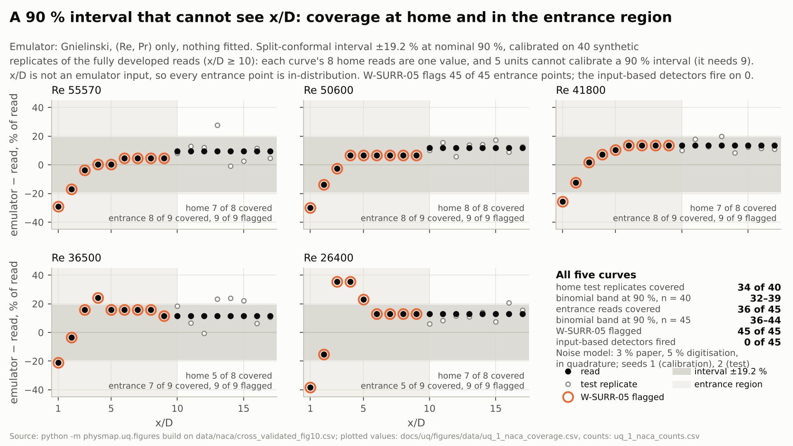
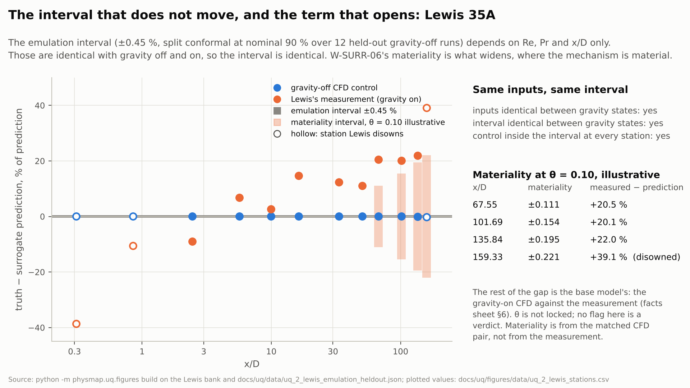

# Uncertainty quantification around the two checks

The surrogate replaces a simulation. Its uncertainty has two kinds, and Roy and Oberkampf's
accounting keeps them apart: **aleatory** (input variability, propagated by sampling) and
**epistemic** (lack of knowledge, carried as intervals and never averaged away). The
machine-learning UQ toolbox — ensembles, dropout, Bayesian layers, conformal intervals —
quantifies one epistemic term: the surrogate's error relative to its training distribution. It
is silent about the model-form term the surrogate inherits from the physics it learned, because
that term is not in the inputs.

PhysMAP's two checks speak to exactly that term. **W-SURR-05** (a closure used outside its
validated range) says whether any validation evidence bounds it at all. **W-SURR-06** (an
omitted mechanism, active and material) estimates its size when a mechanism model exists. This
directory shows both on PhysMAP's two cases, and ships the minimal propagation that carries the
terms, separately, into a probability box.

| Piece | Where | Rebuild / check |
|---|---|---|
| Q1 coverage figure, NACA | [`figures/uq_1_naca_coverage.png`](figures/uq_1_naca_coverage.png), tables in [`figures/data/`](figures/data/) | `python -m physmap.uq.figures build naca` / `check naca` |
| Q2 materiality-interval figure, Lewis 35A | [`figures/uq_2_lewis_materiality.png`](figures/uq_2_lewis_materiality.png), tables in [`figures/data/`](figures/data/) | `python -m physmap.uq.figures build lewis` / `check lewis`; the twelve held-out refits: `python -m physmap.uq.lewis --recompute` |
| Q3 `physmap uq`, the propagation | `src/physmap/uq/pbox.py`; worked inputs and reports in [`examples/`](examples/) | `physmap uq --help`; the examples are rerun by `check` |
| Captions | [`figures/README.md`](figures/README.md) | generated by `build` |
| Handoff | [`../handoff/uq-q1-q3.md`](../handoff/uq-q1-q3.md) | — |

Every number on a figure comes from a table beside it. Counts are per Reynolds curve or per
station and are never pooled across cases. No detection rate is computed anywhere. θ is not
locked; wherever it appears it is the illustrative value 0.10, the original study's.

---

## Q1 — a 90 % interval that cannot see x/D (NACA TN-1451)



**Setup.** The emulator takes (Re, Pr) only. Its interval is split conformal at a nominal 90 %,
calibrated on fully developed points (x/D ≥ 10), the closure's validated range. x/D is not an
emulator input, so every entrance point is in-distribution to the interval and to any
input-based detector. That is the point of the figure: the interval's coverage says nothing about
whether the physics applies.

**The data decided the method.** The 40 fully developed points are 5 Reynolds curves of 8 reads,
and within each curve the 8 reads are one number (the digitised asymptote). Attempt A, a
data-trained surrogate with a split-conformal interval, is recorded in
[`figures/data/uq_1_naca_calibration_attempts.csv`](figures/data/uq_1_naca_calibration_attempts.csv):

| Attempt | Exchangeable units | k = ⌈0.9 (n + 1)⌉ | Result |
|---|---|---|---|
| one unit per Reynolds curve | 5 | 6 > 5 | no finite 90 % interval; it needs 9 units |
| one unit per read (power law on odd x/D, calibrated on even x/D) | 20 | 19 | a finite half-width (1.6 %) whose 20 calibration scores carry 5 distinct values: the "held-out" reads are copies of training reads and test nothing new |

So the first kill criterion fired, and the figure uses the fallback it names: the **Gnielinski
correlation as the emulator (nothing fitted)**, with the digitisation's declared noise model as
**synthetic replicates** of the fully developed reads — 3 % paper reproducibility and a 5 %
digitisation floor, in quadrature (relative sd 0.0583), from the CSV's own header. Calibration
replicates use seed 1, test replicates seed 2. Entrance points are scored as read, no replicates.
The figure says so.

**The interval.** Half-width **19.2 %** (the 37th smallest of 40 calibration scores). It is wide
because Gnielinski sits 9–14 % above the measurement on every fully developed curve and the noise
adds 6 %: the interval learned the closure's home bias, which is what a validation metric is.

**Coverage, counts never pooled across cases** ([`figures/data/uq_1_naca_counts.csv`](figures/data/uq_1_naca_counts.csv)):

| Curve | Home test replicates covered (of 8; band 5–8) | Entrance reads covered (of 9; band 6–9) | W-SURR-05 flagged (of 9) | Input-based detectors fired (of 9) |
|---|---|---|---|---|
| Re 55570 | 7 | 8 | 9 | 0 |
| Re 50600 | 8 | 8 | 9 | 0 |
| Re 41800 | 7 | 8 | 9 | 0 |
| Re 36500 | 5 | 7 | 9 | 0 |
| Re 26400 | 7 | 5 (below the band) | 9 | 0 |
| all five curves | 34 of 40 (band 32–39) | 36 of 45 (band 36–44) | 45 of 45 | 0 of 45 |

The bands are the central 95 % of Binomial(n, 0.90). Home coverage is inside the band; the
acceptance holds. Entrance coverage sits at the bottom edge of its band over all five curves and
below it on the lowest-Re curve; the 9 uncovered entrance reads are the inlet point of every
curve and x/D 3–5 on the two lowest curves — the same points that exceed the benchmark's 17.5 %
threshold in the README. The other 36 entrance reads are inside the interval: numerically close,
but not supported by validation evidence for this region, and W-SURR-05 flags all 45 while the
interval and the input-based detectors cannot tell them apart from home.

**What the figure does not show.** The 40 reads are 5 values, so this is not a test of the
interval on a new Reynolds number; it is a test of the noise model plus the closure's home bias.
A test on new Re needs more curves than TN-1451 Fig 10 holds. Said on the figure and here.

## Q2 — the interval that does not move, and the term that opens (Lewis 35A)



**Setup.** Design M's surrogate — the headline of `physmap stress-test lewis-reuse` — is a
Gaussian process on 13 gravity-off CFD runs (532 rows). Its **emulation-error interval** is
calibrated the only honest way the data allows: hold out one whole DOE run, refit on the rest,
score the held-out run, for each of the 12 DOE runs (the matched run stays in training, as design
M has it). The nonconformity unit is a run, because rows along one tube are not exchangeable with
each other; at nominal 90 % with 12 units, k = 12, so the half-width is the largest per-run worst
relative error: **±0.45 %** ([`figures/data/uq_2_lewis_heldout_runs.csv`](figures/data/uq_2_lewis_heldout_runs.csv)).
The row-level half-width, for information only, is 0.11 %.

**The identical-interval fact.** The interval is a function of (Re, Pr, x/D) and the half-width.
The bank asserts the inputs are identical with gravity off and on; the code asserts the interval
is too. The gravity-off control sits inside it at every station (within 0.06 %). With gravity on,
the measurement is outside it at 12 of 12 stations — and the interval has no way to
say so, because nothing it sees changed.

**The term that opens.** W-SURR-06's materiality from the matched ablation, applied where it
reaches the illustrative θ = 0.10 ([`figures/data/uq_2_lewis_stations.csv`](figures/data/uq_2_lewis_stations.csv)):

| x/D | comparable | materiality (bank) | term at θ = 0.10 | measurement − prediction, % of prediction |
|---|---|---|---|---|
| 67.55 | yes | 0.111 | ±0.111 | +20.5 % |
| 101.69 | yes | 0.154 | ±0.154 | +20.1 % |
| 135.84 | yes | 0.195 | ±0.195 | +22.0 % |
| 159.33 | no — Lewis disowns it (flange heat loss) | 0.221 | ±0.221 | +39.1 % |

The three comparable stations reproduce the bank's 0.111, 0.154, 0.195. The materiality
interval is symmetric here because the propagation does not assume the sign; the ablation does
give one (buoyancy raises Nu in this aiding flow), and a signed interval is a legal declaration
(`materiality_low`, `materiality_high`) the figure does not use. The remaining gap to the
measurement is the base model's — the gravity-on CFD against the measurement, 1.6–6.6 % downstream
(talk facts sheet §6). Materiality comes from the CFD pair, not from the measurement; the link
between it and the error is partly built in, which is one reason no rate is computed.

## Q3 — `physmap uq`, the minimal propagation

```
physmap uq --samples SAMPLES.csv (--predict module:function | --predictions PRED.csv) \
           --terms TERMS.csv [--inputs Re,Pr] [--emulation X] [--theta 0.10] \
           [--quantiles 0.05,0.5,0.95] [--out report.json]
```

| Input | What it carries |
|---|---|
| `--samples` | aleatory input samples: a `point` column and the input columns, one row per sample. One row per point means no declared input variability: the CDF is a step. |
| `--predict` / `--predictions` | a callable `module:function`, called as `fn(**{column: array})` per point; or a CSV of `point, prediction`, one row per sample or one per point |
| `--terms` | per point, **relative to the prediction**: `emulation` (held-out emulation error); `closure_status` inside/outside; `validation` (the declared validation metric, used inside); `extrapolation_band` (used outside; blank means **UNBOUNDED**); `materiality` (from an ablation; `none` means **not assessed**). Any term may be signed as `<term>_low`/`<term>_high`. A term that is not declared is an error, not a zero. |
| `--theta` | apply the materiality term where materiality ≥ θ; the report labels θ illustrative |

**Output.** Per point: the aleatory quantiles; each term on its own line with its interval and
status; the total epistemic interval (their Minkowski sum) or `unbounded`; the probability box at
the named quantiles as `[lower, upper]`; and the identity the arithmetic guarantees, the relative
box width equals the sum of the term widths. Never one number.

**Acceptance, on the committed examples** (rerun by `python -m physmap.uq.figures check`;
asserted in `tests/test_uq.py`):

| Case | Example | Check | Result |
|---|---|---|---|
| NACA, fully developed | [`examples/naca_report.json`](examples/naca_report.json) | box width = emulation (0, the emulator is the closure) + validation (2 × 19.2 %) | holds on 40 of 40 |
| NACA, entrance | same | outside the validated range, no band declared → UNBOUNDED | 45 of 45 report `unbounded` |
| NACA, kill criterion 2 | same | box half-width ≤ measured band (19.2 %) + emulation (0) | equal; passes |
| Lewis | [`examples/lewis_report.json`](examples/lewis_report.json) | box width = 2 × emulation (0.45 %) + 2 × materiality, materiality applied only where θ = 0.10 flags | widens at x/D 67.55, 101.69, 135.84 (and the disowned 159.33), nowhere else |

The NACA example's aleatory spread (Re with a 2 % relative sd, 50 samples per point) is
illustrative — TN-1451 declares no input uncertainty — and the samples file says so in its first
line, which the report echoes. The Lewis example has one nominal sample per station, so its box
is the epistemic interval alone.

## Dependencies and hygiene

numpy and scipy only; matplotlib stays under the `experiment` extra and is imported only by the
figure builder. `import physmap` and `physmap --help` stay free of numpy, scipy, sklearn and
joblib; a test in `tests/test_uq.py` holds that line. `tools/talk_package.py check` is untouched:
nothing here lives under `docs/talk/`.
